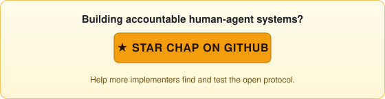
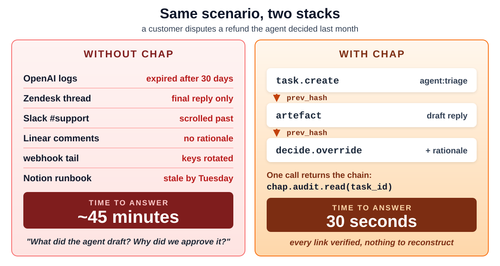
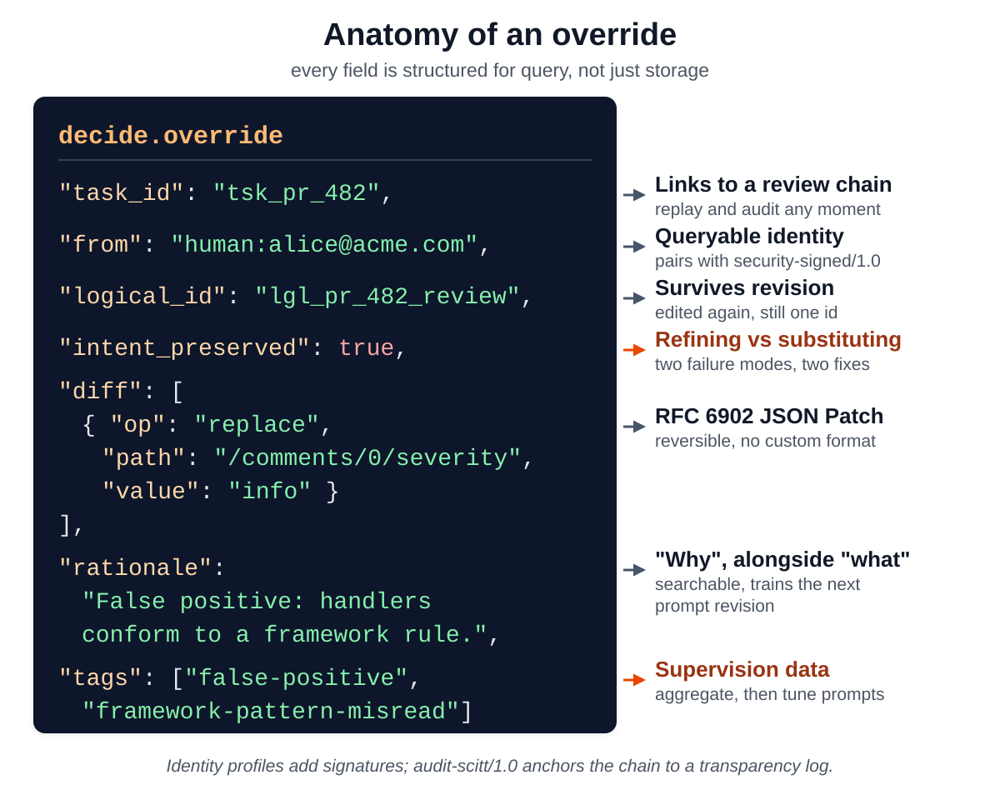

<div align="center">

# Collaborative Human-Agent Protocol (CHAP)

<p align="center">
  <a href="https://github.com/BrightbeamAI/chap/releases/latest"></a>
  <a href="https://pypi.org/project/chap-coordinator/"></a>
  <a href="https://www.npmjs.com/package/@brightbeamai/chap-coordinator"></a>
  <a href="https://github.com/BrightbeamAI/chap/actions/workflows/ci.yml"></a>
  <a href="https://github.com/BrightbeamAI/chap/blob/main/LICENSE-SPEC.md"></a>
  <a href="https://github.com/BrightbeamAI/chap/blob/main/LICENSE"></a>
</p>

<p align="center">
  <strong>The open protocol for humans and agents doing accountable work together.</strong>
</p>

<p align="center">
  CHAP gives approvals, overrides, handoffs and escalations one shared, auditable shape across MCP and A2A.
</p>

<p align="center">
  <a href="./START_HERE.md"><strong>Start here</strong></a> ·
  <a href="#concepts">Concepts</a> ·
  <a href="#install">Install</a> ·
  <a href="./docs/tour.md">90-second tour</a> ·
  <a href="./examples/drive-chap-from-claude-desktop.md">MCP quickstart</a> ·
  <a href="./IN_PRACTICE.md">Scenarios</a> ·
  <a href="./IMPLEMENTATIONS.md">Implementations</a> ·
  <a href="https://github.com/BrightbeamAI/chap/wiki">Wiki</a> ·
  <a href="https://github.com/BrightbeamAI/chap/discussions">Discussions</a> ·
  <a href="https://brightbeam.works/chap/">Website</a> ·
  <a href="https://arxiv.org/abs/2606.09751">Paper</a>
</p>

<p align="center">
  <a href="https://github.com/BrightbeamAI/chap">
    
  </a>
</p>

</div>

---

<p align="center">
  
</p>

---

Work is moving towards teams in which hundreds of agents and hundreds of people take part. Agents draft, triage and recommend; people approve, correct, overrule and escalate. Those human decisions make the work accountable, yet they are usually recorded only in chat threads, ticket comments and memory.

CHAP gives those decisions a defined structure and an auditable record: what the agent produced, what the person decided and why, in one log that can be queried and verified.

- **Structured overrides.** When a person edits an agent's work, the edit is recorded with a diff, a rationale and tags your team defines, so corrections can be analysed later.
- **A tamper-evident log.** Every change is recorded in order. With the hash chain on, an altered entry is detected on verification, provided a recent chain head is kept out of the operator's reach ([`SECURITY.md`](./SECURITY.md) §5). The history survives key rotation, expired vendor logs and staff changes.
- **Signatures and identity.** Optional extensions, called profiles, require every call to be signed, bind signing keys to verified identities, and submit entries to a transparency log.
- **Alongside MCP and A2A.** MCP connects agents to tools and A2A connects agents to each other; CHAP records the work agents share with people.

## Concepts

CHAP is a protocol: a set of calls that agents, people and their tools send to a **coordinator**, the service that mediates a workspace. The coordinator checks each call against the workspace's rules, answers it, and records each accepted change in the workspace's audit log. The TypeScript and Python packages below are coordinators, to embed in your own process or run as a server.

| Term | What it is |
|---|---|
| **Workspace** | A named context for one body of work: its members, its tasks, and the profiles it uses |
| **Participant** | A member, named by a URI such as `human:alice@example.org` or `agent:triage`; `group:` names a set of members |
| **Task** | A unit of work, assigned to a participant |
| **Artefact** | What a participant produces in a task: a draft, a decision, an override |
| **Envelope** | One call, as a JSON-RPC 2.0 message; its `method` is the verb, such as `task.create` or `decide.approve` |
| **Audit log** | The ordered record of every change to the workspace; with the hash chain on, each entry carries the hash of the one before it |

The verbs read as their names. A task is created, completed and sent for review (`task.create`, `task.complete`, `review.request`). A reviewer approves, rejects or overrides it (`decide.approve`, `decide.reject`, `decide.override`). Work is handed off or escalated (`handoff.propose`, `escalate.raise`), and `audit.read` returns the record.

**Core and profiles.** Every coordinator implements **Core** (`core/1.0`): workspaces, participants, tasks and the audit log. Everything else is an optional **profile**, named with its version. `review/1.0` adds review requests and decisions. Others add quick questions to a person (`whisper/1.0`), group votes (`deliberation/1.0`), handoffs (`handoff/1.0`), pausing and rollback (`control/1.0`), routing (`routing/1.0`), shadow and trial modes (`modes/1.0`), signed calls (`security-signed/1.0`), verified identities (`identity-oidc/1.0`, `identity-vc/1.0`) and a transparency log (`audit-scitt/1.0`). A workspace advertises the profiles it uses, and the coordinator refuses calls that belong to any other profile. [`core/SPEC.md`](./core/SPEC.md) fits Core on one page, [`profiles/PROFILES.md`](./profiles/PROFILES.md) lists the profiles, and [`GLOSSARY.md`](./GLOSSARY.md) defines every term.

## Install

| For | Run |
|---|---|
| TypeScript | `npm install @brightbeamai/chap-coordinator` |
| Python | `pip install chap-coordinator` |
| A new project with a review desk | `npx create-chap-app my-gate` |

Each package implements Core and every profile; a new workspace advertises `core/1.0` and `review/1.0` unless you name others. [`START_HERE.md`](./START_HERE.md) is the full guide: a first recorded decision from a clone of this repository, with Python alone, and every other way in.

## The override envelope

The override envelope records a reviewer's change to an agent's output. Each field is annotated below:

<p align="center">
  
</p>

`intent_preserved` separates a refining override, which keeps the agent's decision and rewrites its wording, from a substituting one, which decides differently. `tags` are the small vocabulary a team agrees on and counts by later. [`ABOUT.md`](./ABOUT.md#the-override-envelope) says what each points at.

## Status

CHAP 0.3 is a public draft: a small Core and optional profiles ([`SPECIFICATION.md`](./SPECIFICATION.md)), with reference coordinators in TypeScript and Python that a differential fuzzer checks answer and log alike. Before 1.0 a minor release may break things, and its changelog lists each break with a migration. [`ABOUT.md`](./ABOUT.md#status) says what is built so far, and [`ROADMAP.md`](./ROADMAP.md) sets out the milestones to 1.0.

## Read this next

| Read | For |
|---|---|
| [`START_HERE.md`](./START_HERE.md) | A first recorded decision, and every way in |
| [`docs/tour.md`](./docs/tour.md) | The 90-second tour: a clip of one review, and the code for each step in TypeScript and Python |
| [`IN_PRACTICE.md`](./IN_PRACTICE.md) | Scenarios, from a solo developer with Cursor to GMP-regulated manufacturing |
| [`ABOUT.md`](./ABOUT.md) | How Core and the profiles are adopted, what the override envelope's fields point at, how CHAP sits with MCP and A2A, the standards it reuses, the status and the repository's layout |
| [`SPECIFICATION.md`](./SPECIFICATION.md) | Core and every profile, in one document |
| [`core/SPEC.md`](./core/SPEC.md) | Core, on one page |
| [`profiles/PROFILES.md`](./profiles/PROFILES.md) | The optional profiles, and how they combine |
| [`GLOSSARY.md`](./GLOSSARY.md) | Every term |
| [`IMPLEMENTATIONS.md`](./IMPLEMENTATIONS.md) | The packages, the framework bridges and other implementations |
| [`packages/chap-analytics/`](./packages/chap-analytics/) | The audit log as pandas tables and charts |
| [`SECURITY.md`](./SECURITY.md) | The threat model, and how to report a vulnerability |
| [`CHANGELOG.md`](./CHANGELOG.md) | What changed in each release |
| [`CONTRIBUTING.md`](./CONTRIBUTING.md) | How to contribute; [`GOVERNANCE.md`](./GOVERNANCE.md) for how the protocol evolves |
| [The technical report](https://arxiv.org/abs/2606.09751) | The architecture, profile semantics and threat model, with the scenarios as JSON traces |

## Cite

If you reference CHAP in academic or technical work, please cite the technical report.

<details>
<summary>BibTeX</summary>

```bibtex
@techreport{chap2026,
  author      = {Shahid, Arsalan and Suttie, Gordon and Black, Philip},
  title       = {Collaborative Human-Agent Protocol (CHAP): An open protocol for auditable, structured multi-human and multi-agent collaboration},
  institution = {Brightbeam AI},
  year        = {2026},
  type        = {Technical Report},
  number      = {arXiv:2606.09751},
  url         = {https://arxiv.org/abs/2606.09751}
}
```

</details>

---

CC BY 4.0 (specification text, see LICENSE-SPEC.md) · Apache 2.0 (everything else) · Any language, any deployment.
