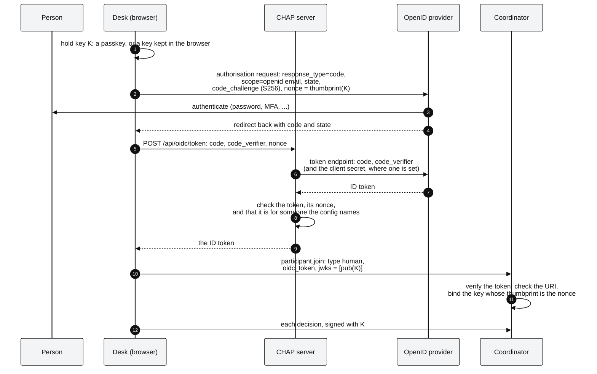

# CHAP + OIDC / OAuth 2.0

This document describes how CHAP 0.3.5 uses OpenID Connect (OIDC) and
OAuth 2.0 to say who a person is, and how that binds the key their
decisions are signed with.

CHAP itself is **identity-provider-agnostic**: it needs each participant
who signs to hold a signing key the workspace knows. OIDC is how a person
proves who they are when that key is registered. The desk a
`create-chap-app` server runs signs a person in at the organisation's
OpenID provider, and the coordinator checks the provider's ID token when
the person joins, under the `identity-oidc/1.0` profile.

| Concern | How 0.3.5 answers it |
|---|---|
| Who is this person? | An ID token from the workspace's OpenID provider, checked at `participant.join`. |
| Which participant URI is theirs? | The one the token's `chap_participant_uri` names, or the one whose invitation gives the token's subject as `oidc_sub`. |
| Which key signs for them? | The key the token attests: its `cnf.jwk`, or the key whose RFC 7638 thumbprint is the token's `nonce`. |
| Is a sign-in fresh enough for a privileged call? | `auth_time` against the workspace's step-up window, where the coordinator enforces step-up. |
| How do agents and services sign? | With keys of their own, registered when they join; under the `"humans"` signature policy an agent member may call unsigned. |
| What may a member do? | What the workspace's rules let its role and type do. The token says who someone is, and grants nothing. |

---

## 1. A person signs in at the desk

The desk uses the authorisation code flow with PKCE (RFC 7636). The
`nonce` it asks the provider for is the RFC 7638 thumbprint of the key it
signs with, so the ID token attests that key, and the server, never the
browser, redeems the code:



1. **The key.** The desk signs with a passkey where the browser has one
   that verifies its user, or with a key it keeps in the browser. Every
   key's `kid` is its RFC 7638 thumbprint.
2. **The request.** The desk sends the browser to the provider's
   authorisation endpoint with `response_type=code`, the `openid` and
   `email` scopes, a `state`, a PKCE `code_challenge` (S256) and a `nonce`
   that is the thumbprint of the key: base64url of SHA-256 over the key's
   required members, `{crv, kty, x}` for an Ed25519 key and
   `{crv, kty, x, y}` for a P-256 one, with no padding.
3. **The code.** The provider sends the browser back with a code. The desk
   posts it to its server, `POST /api/oidc/token`, with the PKCE verifier
   and the nonce. The server redeems the code at the provider's token
   endpoint, with the client secret where the deployment has one, which
   the browser never sees. It checks the ID token as the join will, holds
   its nonce to the one the desk asked for, and gives the token to the
   desk.
4. **The join.** The desk joins the person with the token and the key.
   The coordinator verifies the token, checks that it names this
   participant, and registers the key the token attests.

The production template's README says how to register the desk as a
client at a provider, with notes for Google and Microsoft Entra ID.

---

## 2. The token, and what it binds

The coordinator reads these claims from a verified token:

```json
{
  "iss": "https://login.example.org",
  "sub": "248289761001",
  "aud": "chap-desk",
  "exp": 1793433600,
  "auth_time": 1793430000,
  "acr": "urn:example:authn:mfa",
  "nonce": "kVhL2b8m4JpI8nQf3tq1jTq3wW8RcQ1hYbD0w2bKj5E",
  "email": "alice@example.org",
  "chap_participant_uri": "human:alice@example.org"
}
```

**The check.** The server reads the provider's discovery document,
`<issuer>/.well-known/openid-configuration`, which must name the issuer
exactly, and the keys it publishes (`jwks_uri`). A token is accepted when
it is a JWT signed with RS256, ES256 or EdDSA by one of those keys, carries
the issuer as `iss`, is issued to the desk's client id (`aud`, and `azp`
where it names one), is inside its validity window and names a subject. A
token naming a key the provider does not publish is refused, and the keys
are fetched again for the next join, so a rotation at the provider costs
one refused join.

**The participant.** A token joins a person only as the participant it
names:

- by `chap_participant_uri`, which a provider that knows CHAP puts in its
  tokens; or
- by its subject, where an invitation to the workspace gives that subject
  as `oidc_sub`. A `create-chap-app` server gives each person in
  `chap.config.json` their `oidc_sub` the same way.

A token that names no one the workspace expects is refused, so an account
at the provider is not by itself a way in. A token for another
participant than the join's `from` is refused with `-32404`, and a join as
a person with no token, or with one that fails a check, with `-32403`.

**The key.** A verified token binds the key it attests, and the join's
keys must match it:

- a token with a `cnf.jwk` (RFC 7800) binds that key; one with no `kid` is
  bound by its thumbprint;
- a token with no `cnf.jwk` binds the one key of the join whose
  thumbprint is the token's `nonce`, which is how the desk's sign-in
  attests the key, since a provider does not put a client's key in its
  tokens.

A join whose keys do not match what the token attests is refused, and a
person verified by a token never has a key registered on their own say.

**The record.** The join is recorded on the chain with the token replaced
by `"sha256:<hex of the token's UTF-8 bytes>"`, so the chain never holds
the token or the personal data in it.

---

## 3. Signing a call

A signed call carries a top-level `sig`. For an Ed25519 key it is
`ed25519:<kid>:<signature>`, the signature in base64 over the JCS
canonical form (RFC 8785) of the envelope without its `sig`:

```typescript
const canonical = canonicalize(envelopeWithoutSig);          // JCS
envelope.sig = `ed25519:${kid}:${base64(ed25519.sign(key, canonical))}`;
```

A passkey signs through WebAuthn, with the base64url SHA-256 of the same
canonical bytes as the challenge, and the tag
`webauthn:<kid>:<authenticatorData>.<clientDataJSON>.<signature>`. The
coordinator verifies a signature against the key that was valid for
`from` when the call was made, and refuses a failure with `-32070`.

Which calls must be signed is the workspace's signature policy: under
`"all"`, every call; under `"humans"`, every call but those of agent
members. `participant.join` and `workspace.create` are exempt.

---

## 4. Step-up authentication

A coordinator can hold people to a fresh sign-in for privileged methods:
every `control.*` method, `workspace.set_profiles`,
`participant.rotate_key` and `participant.revoke_key`. With step-up
enforced (`enforceStepUp`, `enforce_step_up` in Python), such a call from
a person, or any member bound to an OIDC subject, is refused with
`-32402` when the `auth_time` of their latest verified token is missing or
older than the workspace's window, `step_up_window_sec` (five minutes by
default, published by `workspace.describe`), or when their token's `acr`
differs from the workspace's `min_acr` where one is set.

A person renews `auth_time` by signing in again and joining with the new
token. The `create-chap-app` servers do not turn step-up on.

---

## 5. Agents and services

Agents and services have no person at a browser, so the sign-in above is
not theirs. Each signs with a key of its own, registered when it joins:
the production template gives its agent a key file. Under the `"humans"`
signature policy an agent member may call unsigned, and a service signs.

Where a deployment provisions workload keys from its own identity
infrastructure, a SPIFFE SVID or a certificate from a private CA, the key
that results is registered at the join like any other. CHAP does not read
those credentials itself.

---

## 6. What a member may do

The token says who a person is; the workspace decides what they may do.
A member's rights come from their type and role under the coordinator's
rules: only a person decides a task that requires review, an author never
decides their own work, and the `admin` role is open only to the
workspace's first member and to those an admin's invitation names. No
claim in a token grants a role.

---

## 7. Key rotation and loss

- **Rotation.** `participant.rotate_key` registers a new key, signed with
  the old one. The old key still verifies the calls made before the
  rotation.
- **Revocation.** `participant.revoke_key` ends a key: a member may revoke
  their own, and an admin anyone's. The revocation is on the chain, and a
  revoked key still verifies calls made before it.
- **Loss.** A person who loses their only key, such as a browser key whose
  storage was cleared, cannot sign the rotation. An admin revokes the lost
  key, and `workspace.invite` for the member, who then holds no valid key,
  registers the keys the invitation pins: the way back in.

---

## 8. Signing out

CHAP keeps no session. A key stays the member's until it is rotated or
revoked, whatever happens at the provider. Signing out of the desk, or a
session ending at the provider, changes nothing at the coordinator; a
person leaving a device they no longer trust revokes the key it holds.

---

## 9. Personal data and the audit chain

The chain records each call under the participant URI, with the key and
the signature, and records a join's token as its hash. The coordinator
keeps a person's OIDC subject with their membership, which
`workspace.describe` reports, and nothing else from the token. Mapping a
URI to a person's details is left to the deployment's own records.

---

## 10. Recap

| Question | Answer in 0.3.5 |
|---|---|
| How does CHAP know who a person is? | An ID token from the workspace's OpenID provider, checked at `participant.join`. |
| How does the desk sign them in? | The authorisation code flow with PKCE; the server redeems the code. |
| Which key is theirs? | The token's `cnf.jwk`, or the join's key whose RFC 7638 thumbprint is the token's `nonce`. |
| Which URI is theirs? | The token's `chap_participant_uri`, or the one whose invitation gives the token's subject as `oidc_sub`. |
| Where does the key live? | In the desk: a passkey, or a key kept in the browser. |
| How do privileged calls require a fresh sign-in? | `auth_time` against `step_up_window_sec`, where step-up is enforced. |
| How do agents and services sign? | With keys of their own, registered at the join. |
| What is on the chain? | URIs, keys and signatures; a join's token only as its hash. |
| How is a key rotated? | `participant.rotate_key`, signed with the old key. |
| What if a key is lost or compromised? | `participant.revoke_key`; an admin's invitation registers a new key. |
